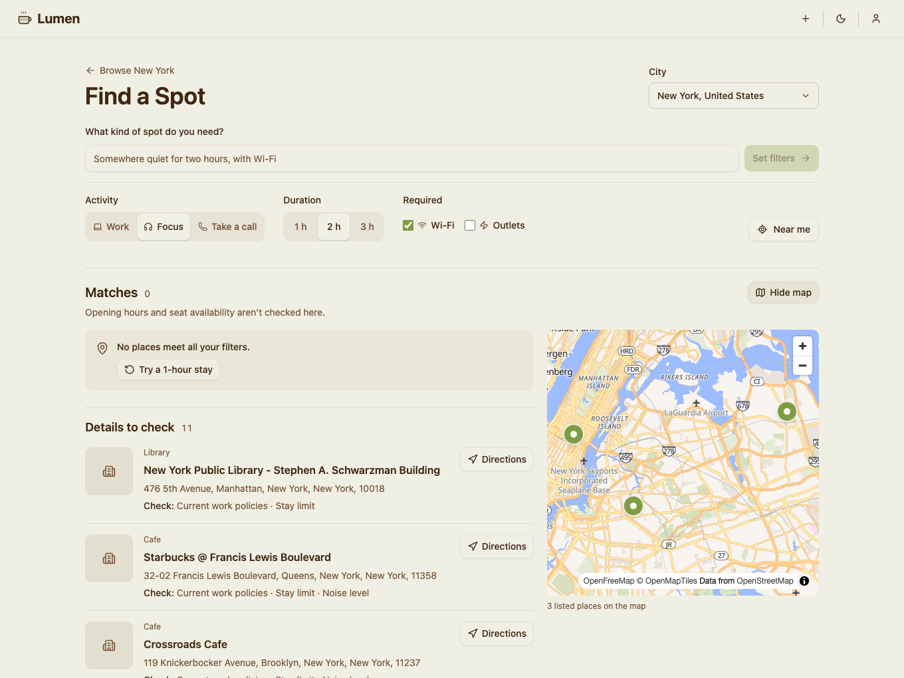

# Lumen

Find a cafe, library, or coworking space where you can get some work done. Lumen helps you decide where to go based on laptop policies, stay limits, Wi-Fi, and outlets, and shows which details still need checking.

[Try Find a Spot](https://lumen-lime.vercel.app/find?city=new-york-united-states) · [Browse cities](https://lumen-lime.vercel.app/cities) · [Read the architecture](docs/engineering/architecture.md)

## Try it in two minutes

1. Open [Find a Spot in New York](https://lumen-lime.vercel.app/find?city=new-york-united-states) and type `Somewhere quiet for two hours, with Wi-Fi`. The app turns the request into filters you can edit.
2. Open the map or inspect a listing. If a fact is missing or out of date, the place appears under **Details to check** instead of **Matches**. Opening hours and seat availability aren't verified by the finder.
3. Visit [Lisbon](https://lumen-lime.vercel.app/cities/lisbon) for the city directory experience, or see the [mobile view](docs/showcase/lisbon-mobile.png). Browsing needs no account; an account lets you save places, mark visits, review venues, and submit corrections or new listings.

## Engineering decisions

- **Match on evidence.** The [matching function](lib/features/find-a-spot/matching.ts) distinguishes missing, negative, and stale facts. The same filters drive the shortlist and map. Plain-English parsing works without an AI service.
- **Make submissions safe to retry.** The [submission transaction](supabase/migrations/20261112000400_submit_workspace_with_city_proposal.sql) writes the listing and photo records together. A first-place submission can propose a city, but that city stays off the public directory until approval.
- **Keep publishing with the reviewer.** Optional AI research proposes field edits. The moderator chooses what to save, and the [review transaction](supabase/migrations/20261112000200_make_ai_review_atomic.sql) records the accepted fields alongside the workspace update.

## Run it locally

Lumen uses Next.js App Router, TypeScript, Tailwind CSS, Supabase, and MapLibre. The [development guide](docs/engineering/development.md) covers Node.js, pnpm, an isolated database, and environment variables. [GitHub Actions](https://github.com/TiagoValenteM/Lumen/actions/workflows/checks.yml) runs lint, type checks, tests, and a production build.

[Demo walkthrough](docs/showcase/walkthrough.md) · [Documentation index](docs/index.md) · [Deployment runbook](docs/operations/deployments.md)

Built by [Tiago Valente](https://github.com/TiagoValenteM). Proudly developed in Switzerland.
